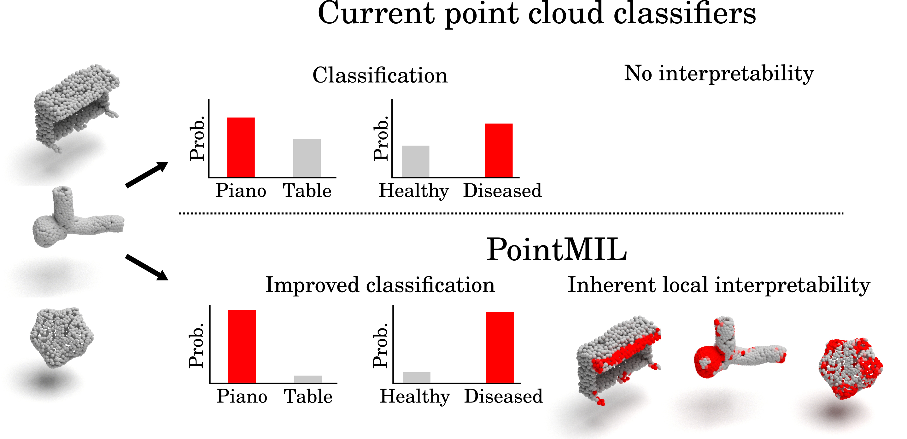

# PointMIL: Interpretable point cloud classification using multiple instance learning

Official code for **"Interpretable point cloud classification using multiple instance learning"**
(Matt De Vries, Reed Naidoo, Olga Fourkioti, Lucas G. Dent, Nathan Curry, Chris Dunsby, Chris Bakal; ICCV 2025).

PointMIL treats a point cloud as a bag of points. A per-point feature extractor
(PointNet, DGCNN, CurveNet, PointMLPElite or the proposed Transformer) produces one
feature vector per point, and a multiple instance learning (MIL) pooling head
(Instance, Attention, Additive or Conjunctive, optionally with contextual
attention over the k nearest neighbours) classifies the cloud while assigning an
importance score to every point. The interpretation is part of the prediction, not
a post hoc approximation. The paper evaluates classification (mACC, oACC, F1) and
interpretability (AOPCR, NDCG@n) on IntrA, the 3D red blood cell dataset,
ModelNet40, ScanObjectNN and the new ATLAS-1 dataset of drug-treated 3D cancer
cells.

- Paper: https://openaccess.thecvf.com/content/ICCV2025/papers/De_Vries_Interpretable_point_cloud_classification_using_multiple_instance_learning_ICCV_2025_paper.pdf
- Supplementary: https://openaccess.thecvf.com/content/ICCV2025/supplemental/De_Vries_Interpretable_point_cloud_ICCV_2025_supplemental.pdf
- Project page and ATLAS-1 dataset: https://sentinal4d.github.io/PointMIL
- ATLAS-1 on Hugging Face: https://huggingface.co/datasets/Sentinal4D/ATLAS-1
- Pretrained models: https://huggingface.co/Sentinal4D (see [Pretrained models](#pretrained-models))

<p align="center"></p>

## Installation

Pure PyTorch, no CUDA extensions to compile. Python 3.10 or newer, PyTorch 2.0 or newer
(the paper used Python 3.10, PyTorch 2.2.2, CUDA 12.1).

```bash
git clone https://github.com/Sentinal4D/PointMIL.git && cd PointMIL
# option A: conda environment pinned to the paper versions, plus unit tests
# (uses mamba or micromamba when installed; the classic conda solver can take hours on this file)
bash install.sh && conda activate pointmil
# option B: into an existing environment with PyTorch 2.x
pip install -e ".[dev]"
```

Optional extras: `pip install -e ".[data]"` (dataset download and RBC preparation),
`".[hub]"` (pretrained models from the Hugging Face Hub), `".[notebook]"` (the
quickstart notebook) and `".[wandb]"` (Weights & Biases logging); combine them as
`pip install -e ".[data,hub,notebook]"`.

`bash scripts/smoke_test.sh` trains every backbone and pooling head for two epochs
on a synthetic dataset on CPU (a few minutes) and is what the CI runs.

## Data preparation

All configs read their data from `${POINTMIL_DATA}/<dataset>`:

```bash
pip install -e ".[data]"
export POINTMIL_DATA=/path/to/datasets      # one sub-folder per dataset
bash scripts/download_data.sh all           # or: intra, rbc, modelnet40, scanobjectnn, atlas1
```

The script downloads what can be downloaded automatically, prints exact instructions
for the rest, and carries on with the next dataset if one step fails.

| Dataset | Folder | Source | Split |
|---|---|---|---|
| IntrA | `IntrA/annotated/ad`, `IntrA/generated/{vessel,aneurysm}/ad` | Google Drive folder of the IntrA authors (https://github.com/intra3d2019/IntrA) | `splits/intra/fold_{0..4}.csv` (5-fold CV) |
| 3D RBC | `RBC/ad/*.ad` | built locally from the public 3D masks with `python scripts/prepare_rbc.py --root $POINTMIL_DATA` (masks: Waibel et al., Zenodo 10.5281/zenodo.7031924, CC BY 4.0, from images by Simionato et al., 2021) | `splits/rbc/fold_{0..4}.csv` |
| ModelNet40 | `ModelNet40/**/*.h5` | downloaded by the script (see below) | official |
| ScanObjectNN (PB_T50_RS) | `ScanObjectNN/{training,test}_objectdataset_augmentedrot_scale75.h5` | terms-of-use form at https://hkust-vgd.github.io/scanobjectnn/ | official |
| ATLAS-1 | `ATLAS-1/metadata.csv`, `ATLAS-1/data/*.obj` (meshes), `ATLAS-1/pointclouds_4096/*.npy` (training point clouds) | https://huggingface.co/datasets/Sentinal4D/ATLAS-1 (CC BY 4.0) | `splits/atlas1/split0.csv` |

The `.ad` files are text files with one point per line (`x y z nx ny nz label`). The
IntrA, RBC and ATLAS-1 loaders subsample 1024 points and normalise each cloud to the
unit ball; ModelNet40 and ScanObjectNN take the first 1024 points of their
pre-normalised clouds.

The RBC point clouds are not redistributed. `scripts/prepare_rbc.py` reads only the 825
64 x 64 x 64 masks from the Zenodo archive (about 7 minutes, no need to download the
whole 3.6 GB zip), takes the vertices and normals of each mask's marching-cubes surface
(`pointmil.data.rbc.mask_to_point_cloud`, no smoothing) and writes files that are
byte-identical to the ones used for the paper.

ModelNet40: the usual host of `modelnet40_ply_hdf5_2048.zip` (shapenet.cs.stanford.edu)
is often offline; the script then downloads the same archive from the copy on the
Hugging Face Hub (`Msun/modelnet40`) and checks its SHA-256. The paper's runs used a
repackaged version of the same 2048-point release (9,843 instead of 9,840 training
clouds); the configs read either, and the released PointMIL(Trans.) instance checkpoint
gives 92.3 % overall accuracy on the Hub copy and 91.8 % on the copy used for the paper.

ATLAS-1: the configs read the 4096-point clouds in `pointclouds_4096/`. With only the
meshes, add `--override data.source=mesh` to sample points from the mesh vertices
instead (for the released PointMIL(DGCNN) instance model: 81.5 % overall accuracy from
the meshes against 82.5 % from the point clouds).

## Quickstart: interpret one point cloud

```python
import os
import numpy as np
from pointmil import prepare_cloud
from pointmil.hub import load_pretrained                                   # pip install -e ".[hub]"

model, info = load_pretrained("intra", "transformer", "conjunctive", fold=0)   # downloads from the Hugging Face Hub
points = np.loadtxt(os.path.join(os.environ["POINTMIL_DATA"], "IntrA/annotated/ad/AN1-_norm.ad"))[:, :6]
                                                                           # [M, 6] xyz + normals (xyz-only models take [M, 3])
x = prepare_cloud(points, num_points=1024)                                 # [1, 1024, 6], unit ball, as in training
out = model(x)
pred = out["bag_logits"].argmax(1).item()                                  # class
importance = model.point_importance(x)[0]                                  # [1024] per-point importance for the predicted class
xyz = out["xyz"][0]                                                        # coordinates the scores belong to
```

`notebooks/quickstart.ipynb` does this for an ATLAS-1 cell and plots the result.
Your own checkpoints load with `pointmil.load_checkpoint("outputs/<experiment>/<run>/best.pt")["model"].eval()`.
`out["interpretation"]` is the raw `[B, C, N]` map (per-point class logits scaled by
attention for Additive and Conjunctive, per-point logits for Instance, the attention
weights for Attention), `out["attention"]` the attention weights where applicable.

## Training

```bash
export POINTMIL_DATA=/path/to/datasets
python scripts/train.py --config configs/table1/intra_transformer_conjunctive.yaml --fold 0 --seed 42
python scripts/train.py --config configs/table2/atlas1_dgcnn_instance.yaml --seed 42 --wandb   # optional W&B logging (pip install -e ".[wandb]")
```

Every config states every hyperparameter (`docs/EXPERIMENTS.md` maps configs to paper
results and documents the two training recipes). The `pointmil` recipe is the original
PointMIL training code. The `openpoints` recipe, used for ATLAS-1, ScanObjectNN and
PointMLPElite, is the training strategy of PointNeXt (Qian et al., NeurIPS 2022) as
implemented in the OpenPoints library: the PointNeXt optimiser and weight-decay
grouping, cosine schedule, label-smoothed cross-entropy, gradient clipping, the
OpenPoints transforms and the OpenPoints encoders. This repository re-implements those
parts in plain PyTorch so that it installs without compiled CUDA extensions;
`tests/equivalence/` checks against OpenPoints that the encoders give the same outputs
and that a training step (forward pass, loss, gradient clipping, weight-decay groups and
AdamW update) gives the same parameters.

ModelNet40 has configs for both recipes: `configs/table2/modelnet40_<backbone>_<pooling>.yaml`
(original PointMIL recipe, matching the ModelNet40 checkpoints on the Hub) and
`configs/table2/modelnet40_openpoints_<backbone>_<pooling>.yaml` (the PointNeXt recipe of
the authors' PointNeXt ModelNet40 runs, which converges much faster: 56 % validation
accuracy after the first epoch against 20 % for DGCNN additive). The PointNeXt recipe is the
better starting point for new ModelNet40 experiments. Outputs go to
`outputs/<experiment>/fold<k>_seed<s>/` (or `outputs/<experiment>/seed<s>/` for the
single-split datasets) with `log.csv` (per epoch), `best.pt`, `last.pt`,
`summary.json` (test metrics of the best and last checkpoint, best validation
values) and the test predictions. Use `--override key=value` to change entries, for
example `--override train.epochs=50 data.batch_size=16 train.val_split=holdout`.

Checkpoints are dictionaries with `model_state_dict`, the full `config`,
`pointmil_version`, `metrics` and `epoch`. `pointmil.checkpoints.load_checkpoint`
also reads the checkpoints of the original code bases (Lightning `.ckpt` and
OpenPoints `.pth` files).

## Evaluation and interpretability

```bash
python scripts/eval.py --checkpoint outputs/table1_intra_transformer_conjunctive/fold0_seed42/best.pt --fold 0 --split test
python scripts/interpret.py metrics --checkpoint outputs/table1_intra_transformer_conjunctive/fold0_seed42/best.pt \
    --split annotated --target_class 1 --context_k 12          # AOPCR and NDCG@n on the 116 annotated IntrA segments (class 1 = aneurysm)
python scripts/interpret.py importance --checkpoint ... --fold 0 --split test --out_dir results/importance  # per-point maps (.npz)
python scripts/noise_robustness.py --checkpoint ... --fold 0 --noise_points 0 50 100 200 500
python scripts/aggregate_results.py runs "outputs/table1_intra_*"   # mean and standard deviation over folds
```

## Reproducing the paper

| Result | Command | Approximate cost (one Quadro RTX 6000, 24 GB; measured while sharing the GPU with a second run) |
|---|---|---|
| Table 1 and the IntrA rows of Table 2 | `bash scripts/reproduce_table1.sh` | 100 runs; 1 to 6 GPU hours each (Transformer 5.3 h for 250 epochs), about two GPU weeks in total; `bash scripts/reproduce_table1.sh transformer conjunctive` for one cell (5 folds, about 1 day) |
| Table 2 RBC | `bash scripts/reproduce_table2.sh rbc` | 1 to 2.5 GPU hours per fold and model (Transformer 2.2 h, DGCNN 0.9 h, PointMLPElite 1.4 h for 100 epochs) |
| Table 2 ModelNet40 | `bash scripts/reproduce_table2.sh modelnet40` | 8 to 14 GPU hours per model (DGCNN: 3.3 minutes per epoch, 250 epochs) |
| ModelNet40, PointNeXt / OpenPoints recipe | `bash scripts/reproduce_table2.sh modelnet40_openpoints` | about 12 GPU hours per model (250 epochs) |
| Table 2 ATLAS-1 | `bash scripts/reproduce_table2.sh atlas1` | about 1 GPU hour per model (DGCNN instance: 100 epochs at 30 s per epoch) |
| Table 2 ScanObjectNN | `bash scripts/reproduce_table2.sh scanobjectnn` | 3 to 8 GPU hours per model |
| Table 2 IntrA PointMLPElite (5 folds) | `bash scripts/reproduce_table2.sh intra_pointmlpelite` | about 3.3 GPU hours per fold and pooling head for 100 epochs (additive: 250 epochs) |
| Supp. Table 3 and Fig. 6 (k sweep) | `bash scripts/reproduce_supp_table3_fig6.sh` | 95 Transformer runs of about 6.5 h each (300 epochs) |
| Supp. Fig. 12 (noise) | `scripts/noise_robustness.py` on the DGCNN IntrA checkpoints | minutes |

`REPRODUCIBILITY.md` reports the numbers obtained with this code from the original
checkpoints and from re-training, next to the paper values, and explains the
checkpoint-selection convention of the original runs. Differences from the paper that
matter when comparing with it:

- **CurveNet CLAIM interpretability (Table 1).** This code gives AOPCR 2.77 and NDCG@n
  0.314 for the CurveNet global-average-pooling baseline (paper: 1.363 and 0.252). Use
  the values from this code.
- **ATLAS-1 accuracies** in the paper are the best of many evaluations with random point
  subsets; this code evaluates one fixed subset per cell and reads 0.5 to 2.6 points lower.
- **ATLAS-1 used one train/validation/test split**, not 5-fold cross-validation.

## Pretrained models

Every checkpoint behind the paper is on the Hugging Face Hub, one repository per dataset,
with the models trained with this code for missing folds and new 5-fold sets under
`retrained/`. Each model is a folder `<backbone>/<pooling>/<fold>/` with
`model.safetensors`, `config.yaml` and `metrics.json`; the model card of each repository
lists every model with its metrics.

| Dataset | Repository | Backbones |
|---|---|---|
| IntrA | [Sentinal4D/pointmil-intra](https://huggingface.co/Sentinal4D/pointmil-intra) | Transformer, DGCNN, PointNet, CurveNet, PointMLPElite |
| 3D red blood cells | [Sentinal4D/pointmil-rbc](https://huggingface.co/Sentinal4D/pointmil-rbc) | Transformer, DGCNN, PointNet, CurveNet, PointMLPElite |
| ATLAS-1 | [Sentinal4D/pointmil-atlas1](https://huggingface.co/Sentinal4D/pointmil-atlas1) | Transformer, DGCNN, PointNet, CurveNet, PointMLPElite |
| ModelNet40 | [Sentinal4D/pointmil-modelnet40](https://huggingface.co/Sentinal4D/pointmil-modelnet40) | Transformer, DGCNN, PointNet |
| ScanObjectNN | [Sentinal4D/pointmil-scanobjectnn](https://huggingface.co/Sentinal4D/pointmil-scanobjectnn) | Transformer, DGCNN, PointNet, PointMLPElite |

```python
# pip install -e .[hub]
from pointmil.hub import load_pretrained, list_pretrained

model, info = load_pretrained("intra", "transformer", "conjunctive", fold=0)   # Table 2 IntrA PointMIL(Trans.)
model, info = load_pretrained("rbc", "dgcnn", "instance", fold=3, retrained=True)
model, info = load_pretrained("atlas1", "dgcnn", "instance")                   # single split
print(info["metrics"])                                                         # test and interpretability metrics
print([m["path"] for m in list_pretrained("atlas1")])                          # everything in a repository
```

Backbone names on the Hub are `transformer`, `dgcnn`, `pointnet`, `curvenet` and
`pointmlpelite`; folds are `fold0` to `fold4` (IntrA, RBC) and a single `split0` (ATLAS-1)
or `official` (ModelNet40, ScanObjectNN) folder. The scripts also take a downloaded
folder as `--checkpoint`:

```bash
hf download Sentinal4D/pointmil-intra --include "transformer/conjunctive/fold0/*" --local-dir hub
python scripts/eval.py --checkpoint hub/transformer/conjunctive/fold0 --split test
```

## Using PointMIL on your own data

Starting from 3D segmentation masks (for example of cells),
[cellshape-helper](https://github.com/Sentinal4D/cellshape-helper) converts each mask to
a mesh and a point cloud (the tool the PointMIL authors use for this step).

1. Write a dataset class. Sub-class `pointmil.data.base.PointCloudDataset`, fill
   `self.items` in `__init__` with one dict per cloud (`{"path": ..., "name": ..., "label": int}`,
   selected by `split`, which is `train` or `test`, plus `validation` if you use it) and
   implement `_load(item)` to return `{"pos": [M, 3] array}` (plus `"normals"` if you have
   them). The base class subsamples, normalises, augments and assembles the model input;
   `pointmil/data/rbc.py` is a short example.
2. Copy a config (for example `configs/table2/atlas1_transformer_additive.yaml` for
   xyz-only clouds or `configs/table1/intra_transformer_conjunctive.yaml` for xyz plus
   normals) and set `data.name` to the import path of your class (`mypackage.cells:MyCells`),
   `data.root`, `data.split_file` (passed to your class), `model.pooling.num_classes` and
   `train.val_split` (`holdout` for a stratified split of the training set).
3. `python scripts/train.py --config my.yaml --seed 42`, then
   `python scripts/interpret.py importance --checkpoint outputs/<experiment>/seed42/best.pt --split test`
   for per-point maps. For clouds with a different number of points set
   `data.num_points` and `model.pooling.num_points` consistently (the non-linear
   classifier variants normalise over the point axis).

Backbones: `transformer`, `pointnet`, `dgcnn`, `curvenet_mil` (original code path),
`openpoints_dgcnn`, `openpoints_pointnet`, `openpoints_curvenet`, `pointmlp_elite`
(OpenPoints code path). Pooling heads: `instance`, `attention`, `additive`,
`conjunctive`, `gap` (CLAIM baseline) and `openpoints` (the OpenPoints-style head).
All are pure PyTorch and run on CPU.

## Tests

`pytest tests --ignore=tests/equivalence` runs the CPU unit tests (shapes of every
backbone and pooling head, contextual attention with k = 0 equals no contextual
attention, AOPCR and NDCG@n on hand-computed cases, checkpoint round trip, config
loading, metrics). `tests/equivalence/` compares the ported modules with the original
code bases weight for weight; it runs only where those repositories are available
(`POINTMIL_REPO_A`: the original PointMIL code, `POINTMIL_REPO_B`: the PointNeXt fork used
for the OpenPoints runs). `ruff check .` lints.

## Repository structure

```
pointmil/            the package: backbones/, pooling/, models/, data/, interpret/, engine/, metrics.py, checkpoints.py, config.py
configs/             one YAML per paper experiment (table1/, table2/, fig6_k_sweep/, smoke/)
splits/              committed fold and split files (intra/, rbc/, atlas1/)
scripts/             train.py, eval.py, interpret.py, noise_robustness.py, aggregate_results.py, reproduce_*.sh, download_data.sh,
                     prepare_rbc.py, convert_checkpoint.py, smoke_test.sh, make_configs.py
                     (authors' provenance tools: prepare_splits.py, prepare_atlas1.py, evaluate_legacy.py, export_hf.py,
                     make_reproducibility.py)
tests/               unit tests (CPU) and equivalence tests against the original code bases (skipped unless those are available)
docs/                EXPERIMENTS.md (config to paper map), reproducibility_template.md
notebooks/           quickstart.ipynb
third_party_licenses/ licence texts of the adapted components (see NOTICE.md)
```

## Citation

```bibtex
@InProceedings{De_Vries_2025_ICCV,
  author    = {De Vries, Matt and Naidoo, Reed and Fourkioti, Olga and Dent, Lucas G. and Curry, Nathan and Dunsby, Chris and Bakal, Chris},
  title     = {Interpretable point cloud classification using multiple instance learning},
  booktitle = {Proceedings of the IEEE/CVF International Conference on Computer Vision (ICCV)},
  month     = {October},
  year      = {2025},
  pages     = {22209-22220}
}
```

The OpenPoints training recipe, the OpenPoints encoders and transforms used for ATLAS-1,
ScanObjectNN and PointMLPElite come from PointNeXt and OpenPoints; if you use them,
please also cite:

```bibtex
@InProceedings{qian2022pointnext,
  title     = {PointNeXt: Revisiting PointNet++ with Improved Training and Scaling Strategies},
  author    = {Qian, Guocheng and Li, Yuchen and Peng, Houwen and Mai, Jinjie and Hammoud, Hasan and Elhoseiny, Mohamed and Ghanem, Bernard},
  booktitle = {Advances in Neural Information Processing Systems (NeurIPS)},
  year      = {2022}
}
```

## Licence

The PointMIL code is released under the Sentinal4D Non-Commercial End User License
Agreement (`LICENSE`): free for non-commercial research, academic and educational
use. Third-party components keep their own licences (MIT, Apache-2.0), listed in
`NOTICE.md` with the full texts in `third_party_licenses/`. The ATLAS-1 dataset is
released under the Creative Commons Attribution 4.0 licence (CC BY 4.0), as stated in
the paper (supplementary section 14.1).

## Acknowledgements

PointMIL builds on PointNeXt and OpenPoints (Guocheng Qian et al.), CurveNet
(Tiange Xiang et al.), PointMLP (Xu Ma et al.), DGCNN (Yue Wang et al.; PyTorch port
by An Tao), the PyTorch PointNet implementation of Xu Yan, the transformer block of
3DMedPT (Jianhui Yu et al.) and the MIL pooling and interpretability metrics of
MILLET (Joseph Early et al., Amazon). We thank the authors of IntrA (Xi Yang et al.),
the 3D red blood cell dataset (Greta Simionato et al.; 3D masks by Dominik Waibel et al.),
ModelNet (Zhirong Wu et al.)
and ScanObjectNN (Mikaela Angelina Uy et al.) for making their data available.
